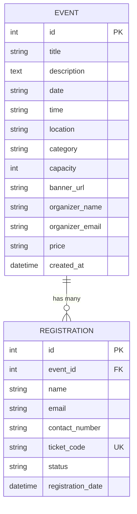

# 🎟️ EventPulse — Event Management System

> **Python Developer Intern Shortlisting Submission**  
> A high-performance, modular, and responsive Event Management System built with **Python 3**, **FastAPI**, **SQLAlchemy ORM**, **SQLite**, and a modern **Single Page Frontend**.

[](https://python.org)
[](https://fastapi.tiangolo.com)
[](https://www.sqlalchemy.org)
[](https://sqlite.org)
[](https://pytest.org)

---

## 📋 Table of Contents
1. [Project Overview](#-project-overview)
2. [Key Features](#-key-features)
3. [Technology Stack](#-technology-stack)
4. [Project Structure](#-project-structure)
5. [Database Architecture](#-database-architecture)
6. [REST API Documentation](#-rest-api-documentation)
7. [Installation & Setup](#-installation--setup)
8. [Running Automated Tests](#-running-automated-tests)
9. [Screen Recording Checklist (2-3 Min Demo)](#-screen-recording-checklist-2-3-min-demo)
10. [Assumptions & Design Decisions](#-assumptions--design-decisions)
11. [Author & Contributions](#-author--contributions)

---

## 🌟 Project Overview

**EventPulse** is a clean, full-stack Event Discovery and Registration platform designed to fulfill all requirements of the Python Developer Intern assessment.

The system allows users to browse scheduled events dynamically from the Python backend, filter by categories, search in real-time, view comprehensive event details, and book confirmed seats with instant digital ticket pass generation and capacity tracking.

### Highlighted Capabilities:
- **Zero-Friction Single-Command Launch**: Backend REST API and Frontend SPA are served seamlessly from the same FastAPI instance.
- **Self-Documenting API**: Live interactive OpenAPI Swagger documentation available at `/docs`.
- **Automated Database Seeding**: Starts with 6 realistic events across technology, music, workshops, and business, with varied capacities (including a sold-out event for edge case testing).
- **100% Test Coverage for Core Workflows**: 15 automated pytest unit and integration tests passing.

---

## ✨ Key Features

| Feature | Description |
| :--- | :--- |
| **Dynamic Event Catalog** | Events are loaded asynchronously from the Python REST API backend via `GET /api/events/`. |
| **Real-time Search & Filter** | Instant search by keyword, title, city, or venue with category pills (`Technology`, `Music`, `Workshop`, `Business`). |
| **Live Seat Availability** | Dynamic calculation of remaining capacity with color-coded progress bars (Indigo = Plenty, Amber = Low, Red = Sold Out). |
| **Capacity & Duplicate Protection** | Atomic backend checks prevent overbooking beyond capacity and block duplicate registrations with the same email for an event. |
| **Instant Digital Pass Issuance** | Generates a unique booking reference code (`TKT-XXXX-XXXX`) upon successful booking, with a printable event pass modal. |
| **"My Bookings" Ticket Lookup** | Attendees can enter their email to retrieve all active ticket passes anytime. |
| **Event Creator (Bonus CRUD)** | Hosts can publish new events with customized seat capacities, categories, dates, and banners. |
| **Responsive Glassmorphism UI** | Designed with clean typography (Inter font), modern dark palette, smooth micro-animations, and loading skeleton states. |

---

## 🛠 Technology Stack

### Backend
- **Python 3.14+**
- **FastAPI**: Modern, async-first web framework with automatic OpenAPI documentation.
- **Pydantic v2**: Strict request/response payload validation, email sanitization, and phone number regex validation.
- **SQLAlchemy 2.0**: Declarative ORM handling models, relationships, and queries.
- **Uvicorn**: High-performance ASGI web server.

### Database
- **SQLite 3**: Embedded relational database (`events.db`) with foreign key constraints, cascading deletes, and indexes on lookup fields.

### Frontend
- **HTML5 & CSS3**: Custom design system utilizing CSS variables, responsive CSS grid/flexbox, glassmorphic navigation, and keyframe animations.
- **Vanilla JavaScript (ES6+)**: Pure, modular asynchronous API client (`fetch`), debounced search, DOM rendering, and modal management without external bundle bloat.

### Testing & Quality
- **pytest & HTTPX**: In-memory SQLite database isolation with fixture-based testing across all endpoints, validation rules, and error cases.

---

## 📁 Project Structure

```
event-management-system/
├── app/
│   ├── __init__.py
│   ├── main.py              # FastAPI app initialization, CORS, static files & lifespan seeder
│   ├── config.py            # Global configuration settings & paths
│   ├── database.py          # SQLAlchemy engine, session maker & get_db dependency
│   ├── models/              # SQLAlchemy Database ORM Models
│   │   ├── __init__.py
│   │   ├── event.py         # Event table definition & computed capacity properties
│   │   └── registration.py  # Registration table definition & ticket code generator
│   ├── schemas/             # Pydantic Schemas & Field Validators
│   │   ├── __init__.py
│   │   ├── event.py         # EventBase, EventCreate, EventResponse schemas
│   │   └── registration.py  # RegistrationCreate & RegistrationResponse schemas
│   ├── crud/                # Database Operations & Business Logic
│   │   ├── __init__.py
│   │   ├── crud_event.py    # Event queries, filtering, search, and category listing
│   │   └── crud_registration.py # Attendee booking, capacity check, and duplicate check
│   ├── api/                 # API Routes & Endpoints
│   │   ├── __init__.py
│   │   └── routes.py        # All REST API endpoints (GET, POST)
│   └── seeds/               # Database Seeding
│       ├── __init__.py
│       └── seed_data.py     # Initial seed events with realistic mock attendees
├── static/                  # Frontend Web Application
│   ├── index.html           # Single Page Application HTML
│   ├── css/
│   │   └── style.css        # Custom responsive styling & design system
│   └── js/
│       └── app.js           # Frontend controller, API integration & DOM updates
├── tests/                   # Automated Test Suite
│   ├── __init__.py
│   ├── conftest.py          # Pytest fixtures & in-memory test database setup
│   ├── test_events.py       # 8 unit tests for events, filtering, and search
│   └── test_registrations.py # 7 unit tests for booking, capacity & validation
├── requirements.txt         # Pinned Python package dependencies
├── run.py                   # One-click launch script
├── README.md                # Comprehensive documentation
└── .gitignore               # Ignored files (caches, envs, local db)
```

---

## 🗄️ Database Architecture

The relational schema maintains strict referential integrity between **Events** and **Registrations**.



### Table Specifications:

#### 1. `events` Table
| Column | Type | Constraints | Description |
| :--- | :--- | :--- | :--- |
| `id` | INTEGER | Primary Key, Auto-increment | Unique Event ID |
| `title` | VARCHAR(200) | Not Null, Indexed | Event title / name |
| `description` | TEXT | Not Null | Detailed event description |
| `date` | VARCHAR(50) | Not Null | Date of event (`YYYY-MM-DD`) |
| `time` | VARCHAR(50) | Not Null | Event time range |
| `location` | VARCHAR(255) | Not Null | Physical venue address or online link |
| `category` | VARCHAR(100) | Not Null, Indexed | Category (`Technology`, `Music`, etc.) |
| `capacity` | INTEGER | Not Null, Default 50 | Total available seats |
| `banner_url` | VARCHAR(500) | Nullable | Image banner URL |
| `organizer_name` | VARCHAR(150) | Not Null | Name of hosting organizer |
| `organizer_email` | VARCHAR(150) | Nullable | Contact email of organizer |
| `price` | VARCHAR(50) | Not Null, Default 'Free' | Ticket price label |
| `created_at` | DATETIME | Not Null, UTC | Record creation timestamp |

#### 2. `registrations` Table
| Column | Type | Constraints | Description |
| :--- | :--- | :--- | :--- |
| `id` | INTEGER | Primary Key, Auto-increment | Unique Registration ID |
| `event_id` | INTEGER | Foreign Key (`events.id`), Not Null | Associated Event ID |
| `name` | VARCHAR(150) | Not Null | Attendee's full name |
| `email` | VARCHAR(150) | Not Null, Indexed | Attendee's email address |
| `contact_number` | VARCHAR(30) | Not Null | Contact phone number |
| `ticket_code` | VARCHAR(50) | Unique, Not Null, Indexed | e.g., `TKT-A4F1-8B92` |
| `status` | VARCHAR(50) | Not Null, Default 'CONFIRMED' | Booking status |
| `registration_date`| DATETIME | Not Null, UTC | Timestamp when registered |

---

## 🚀 REST API Documentation

Interactive Swagger documentation is automatically generated by FastAPI at:
`http://127.0.0.1:8000/docs`

### Endpoints Summary

| Method | Endpoint | Description | Status Code |
| :--- | :--- | :--- | :--- |
| `GET` | `/api/events/` | Retrieve list of available events (supports `?search=` and `?category=`) | `200 OK` |
| `GET` | `/api/events/{id}/` | Retrieve detailed information for a specific event | `200 OK` / `404 Not Found` |
| `POST` | `/api/events/{id}/register/`| Register an attendee for a specific event | `201 Created` / `400 Bad Request` |
| `POST` | `/api/events/` | Create a new event in the database | `201 Created` / `422 Validation Error`|
| `GET` | `/api/categories/` | List all unique event categories | `200 OK` |
| `GET` | `/api/registrations/my-tickets/` | Look up tickets by attendee email (`?email=...`) | `200 OK` |
| `GET` | `/api/stats/` | Overview metrics (total events, registrations, capacity) | `200 OK` |
| `GET` | `/api/health` | Service health status check | `200 OK` |

### Sample Payloads:

#### 1. Register Attendee
**Request**: `POST /api/events/1/register/`
```json
{
  "name": "Jane Doe",
  "email": "jane.doe@example.com",
  "contact_number": "+1 (555) 234-5678"
}
```

**Success Response (`201 Created`)**:
```json
{
  "message": "Successfully registered for 'Global AI & Machine Learning Summit 2026'! Your ticket code is TKT-4B72-9E11.",
  "registration": {
    "id": 4,
    "event_id": 1,
    "name": "Jane Doe",
    "email": "jane.doe@example.com",
    "contact_number": "+1 (555) 234-5678",
    "ticket_code": "TKT-4B72-9E11",
    "status": "CONFIRMED",
    "registration_date": "2026-10-06T04:22:00Z",
    "event_title": "Global AI & Machine Learning Summit 2026",
    "event_date": "2026-10-18",
    "event_time": "09:00 AM - 05:30 PM",
    "event_location": "Convention Center, Hall A, San Francisco"
  },
  "remaining_seats": 46
}
```

**Sold Out Error (`400 Bad Request`)**:
```json
{
  "detail": "Registration closed: 'Exclusive Specialty Coffee Cupping & Roasting Lab' has reached its maximum capacity of 5 attendees."
}
```

**Duplicate Registration Error (`400 Bad Request`)**:
```json
{
  "detail": "Email 'jane.doe@example.com' is already registered for this event with Ticket #TKT-4B72-9E11."
}
```

---

## 💻 Installation & Setup

### Prerequisites
- Python 3.10, 3.11, 3.12, 3.13, or 3.14+
- Modern Web Browser (Chrome, Firefox, Safari, Edge)

### Quick Start (3 Steps):

#### Step 1: Clone Repository
```bash
git clone https://github.com/your-username/event-management-system.git
cd event-management-system
```

#### Step 2: Create and Activate Virtual Environment
- **Windows (PowerShell)**:
  ```powershell
  python -m venv venv
  .\venv\Scripts\Activate.ps1
  ```
- **macOS / Linux**:
  ```bash
  python3 -m venv venv
  source venv/bin/activate
  ```

#### Step 3: Install Dependencies
```bash
python -m pip install -r requirements.txt
```

#### Step 4: Run the Application
You can run using the helper script:
```bash
python run.py
```
*Or directly via Uvicorn:*
```bash
python -m uvicorn app.main:app --reload --host 127.0.0.1 --port 8000
```

### Access Points:
- 🌐 **Web Application**: [http://127.0.0.1:8000](http://127.0.0.1:8000)
- 📄 **Swagger Interactive API Docs**: [http://127.0.0.1:8000/docs](http://127.0.0.1:8000/docs)
- 📑 **ReDoc Alternative Docs**: [http://127.0.0.1:8000/redoc](http://127.0.0.1:8000/redoc)

---

## 🧪 Running Automated Tests

A comprehensive test suite is provided using **pytest** and **HTTPX**. Tests run in an isolated in-memory SQLite database, guaranteeing zero side-effects on local data.

To run all 15 tests:
```bash
python -m pytest -v
```

### Test Coverage Highlights:
- `test_health_check`: Verifies API uptime.
- `test_static_root_page`: Verifies HTML landing page rendering.
- `test_list_events`: Verifies event list retrieval with computed seat counters.
- `test_filter_events_by_category`: Verifies exact category filtering.
- `test_search_events`: Verifies keyword search across title, description, and location.
- `test_get_event_detail_success` & `test_get_event_detail_not_found`: Verifies 200 details and 404 handler.
- `test_create_event_success`: Verifies event publishing persistence.
- `test_register_success`: Verifies attendee registration, ticket generation, and seat decrement.
- `test_duplicate_registration_rejected`: Verifies 400 Bad Request on duplicate email for the same event.
- `test_capacity_limit_enforcement`: Tests event capacity cutoff when limit is reached.
- `test_registration_validation_errors`: Tests 422 errors for malformed emails, short names, and invalid phone numbers.
- `test_lookup_my_tickets`: Tests ticket retrieval for registered attendees.

---

## 📹 Screen Recording Checklist (2-3 Min Demo)

When recording your demonstration video for submission, follow this suggested flow:

1. **Home Page & Branding (0:00 - 0:30)**:
   - Introduce EventPulse, branding, hero section, live stats chips.
   - Point out the category filter pills (`Technology`, `Music`, `Workshop`, `Business`).
2. **Dynamic Event Listing & Search (0:30 - 1:00)**:
   - Demonstrate real-time search (e.g., type "AI" or "Coffee" or "Chicago").
   - Filter by clicking category pills and show dynamic card updating without page reloads.
   - Highlight the dynamic seat counter and the **Sold Out** state on the Coffee Lab event.
3. **Event Details Modal (1:00 - 1:30)**:
   - Click "Details" on an event.
   - Show description, venue, organizer profile, and real-time available seat capacity.
4. **Registration Flow & Instant Digital Pass (1:30 - 2:15)**:
   - Click "Book Your Ticket" / "Register Now".
   - Fill in: Name, Email, Contact Number.
   - Click "Confirm Registration".
   - Show the success modal displaying the digital event pass with unique ticket code (`TKT-XXXX-XXXX`).
   - Notice the event card's remaining seats decrement dynamically!
5. **Edge Cases & API Docs (2:15 - 2:45)**:
   - Try registering again with the same email to demonstrate the friendly duplicate warning toast.
   - Open [http://127.0.0.1:8000/docs](http://127.0.0.1:8000/docs) and execute a quick `GET /api/events/` request to prove pure Python REST API integration.
6. **Ticket Lookup (2:45 - 3:00)**:
   - Click "Find My Ticket", enter the registered email, and show confirmed booking pass.

*Upload the recording to Google Drive and ensure link permission is set to: **"Anyone with the link – Viewer"**.*

---

## 💡 Assumptions & Design Decisions

1. **FastAPI & SQLite Selection**:
   - FastAPI provides native async support, Pydantic type safety, and automatic interactive Swagger documentation (`/docs`), making evaluation effortless.
   - SQLite with SQLAlchemy ORM was selected because it requires zero external database installation, ensuring any reviewer can clone and run in under 30 seconds while remaining fully compatible with PostgreSQL or MySQL via changing the `DATABASE_URL`.
2. **Single-Service Architecture**:
   - Serving the modern SPA through FastAPI's `StaticFiles` eliminates complex Node.js/npm build steps for the evaluator while delivering a fluid, responsive client experience.
3. **Data Integrity & Concurrency**:
   - Capacity checks and duplicate registration checks are evaluated atomically at the database session level before committing a transaction.
4. **Deterministic Testing**:
   - Pytest utilizes `StaticPool` in-memory SQLite tables, creating fresh schemas per test function to guarantee 100% reproducible tests.

---

## 👥 Author & Contributions

- **Role**: Python Developer Intern Candidate
- **Project**: EventPulse - Event Management System
- **Contribution**: Full architecture design, database schema, FastAPI REST API, Pydantic validation, SQLAlchemy queries, seed dataset, responsive UI/UX, and automated test suite.
